# The transaction log panel: a user's guide

How to use the **Transaction log** panel: what each part of it shows, and how
to do the things it is for -- look back at what was done, see how an object
changed, keep a version, work on a branch, and merge.

This is the how-to. Why things are built the way they are is in
`docs/TransactionLog.md`, by section number where this guide names one.

The pictures are taken from the running application by
`scripts/transaction-log-guide-shots.py`; see the end for how to take them
again after the panel changes.

## Contents

1. [What the log is](#1-what-the-log-is)
2. [Opening the panel](#2-opening-the-panel)
3. [The panel at a glance](#3-the-panel-at-a-glance)
4. [The bars at the top](#4-the-bars-at-the-top)
5. [Transactions: what was done](#5-transactions-what-was-done)
6. [Seeing a change in the 3D view](#6-seeing-a-change-in-the-3d-view)
7. [Versions: the document at a moment](#7-versions-the-document-at-a-moment)
8. [Kept: shapes a save would leave out](#8-kept-shapes-a-save-would-leave-out)
9. [Branches](#9-branches)
10. [Merging](#10-merging)
11. [Requests: changes someone sends you](#11-requests-changes-someone-sends-you)
12. [The history in a browser](#12-the-history-in-a-browser)
13. [I want to...](#13-i-want-to)
14. [The same from Python](#14-the-same-from-python)
15. [Taking the pictures again](#15-taking-the-pictures-again)

## 1. What the log is

Every change to a document is written to its **transaction log** as it is
made: one **row** per step (an edit, an undo, a recompute, a save), and under
each row the **operations** of that step -- which property of which object
went from what value to what value.

From that the log gives you:

- the history of the document, step by step, with the values before and
  after;
- **versions**: the whole document as it was at a moment, to look at, open
  or go back to;
- **branches**: a second line of work on the same file, which can be merged
  back;
- **undo of one step** that is not the last one.

The log travels inside the `.FCStd` file. It is on by default; the parameter
is `Preferences/Document/TransactionLog` (0 off, 1 for this session only,
2 written into the file).

## 2. Opening the panel

**View > Panels > Transaction log.** It docks at the bottom, beside the
report view and the Python console.

The panel follows the active document. Its status line tells you when there
is nothing to show:

| Status line | Meaning |
|---|---|
| `No active document` | open or make a document |
| `Name: log off (...)` | the parameter above is 0 |
| `Name: no log yet (made at the first commit)` | nothing has been changed yet |

## 3. The panel at a glance

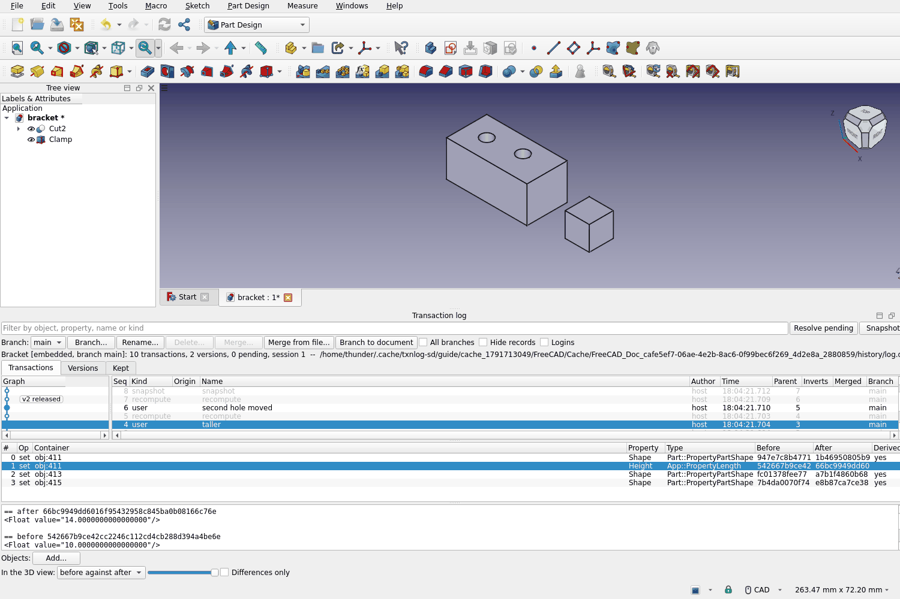

From top to bottom:

1. **Filter, "Resolve pending", "Snapshot"** -- section 4.
2. **The branch bar** -- the branch the document is on, and the buttons that
   make, rename, delete and merge branches -- sections 9 and 10.
3. **The status line** -- the document, whether the log is written into the
   file (`embedded`) or kept for the session, the branch, and counts.
4. **Three tabs:** *Transactions* (what was done), *Versions* (the document
   at a moment), *Kept* (shapes kept in the file).
5. **The detail** of what is selected in the tab: a row's operations, or a
   version's changes.
6. **The value pane:** the stored text of the value selected.
7. **The bar for the 3D view** -- two lines at the bottom, "Objects:" and
   "In the 3D view:" -- section 6.

## 4. The bars at the top

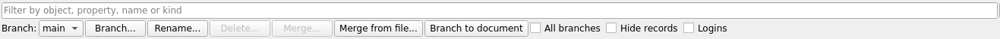

| Control | What it does |
|---|---|
| **Filter** | Shows only the rows that mention the text: an object, a property, a row's name or its kind. |
| **Resolve pending** | A value a recompute wrote is not serialised until something needs it; its "After" reads `pending`. This writes them all now. You rarely need it. |
| **Snapshot** | Takes an unnamed version of the document as it stands (section 7). |
| **Branch:** (list) | The branch the document is on. Choosing another switches the document to it, in place. |
| **Branch...** | A new branch from where you are, switched to. |
| **Rename...** / **Delete...** | Of the branch shown in the list / of another branch. |
| **Merge...** | Merge another branch into this one (section 10). |
| **Merge from file...** | Bring in another copy of this file and merge it (section 10). |
| **Branch to document** | A new branch opened as a second document of the same file, so both can be seen side by side. |
| **All branches** | Show the rows of every branch, not only this branch's history. |
| **Hide records** | Hide the rows that changed nothing: recomputes, saves, snapshots, switches. |
| **Logins** | Show the rows that record a connection to a shared session. |

## 5. Transactions: what was done

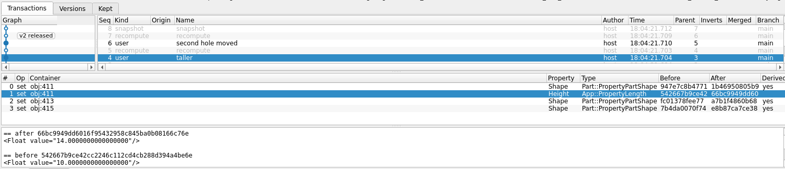

**The rows**, newest at the top. The graph on the left draws the branches as
lines, with a label at each branch's head and at each version.

| Column | Meaning |
|---|---|
| Seq | The row's number in this log. |
| Kind | `user`: a step you made. `implicit`: one made without a name -- a change from the Python console, a recompute. It is not in Edit > Undo: it goes with the step before it, and one undo takes both. `undo`, `redo`. `recompute`: a record that a recompute ran. `save`, `snapshot`, `switch` (of branch), `merge`, `pick` (rows applied from another branch), `squash`, `restore`. Records that changed nothing are grey. |
| Name | The step's name, as in Edit > Undo. |
| Author | Who made it; `host` is you, at this machine. |
| Parent | The row before it on its branch. |
| Inverts | For an undo: the row it undid. |
| Merged | For a merge: the head of the branch merged in. |
| Branch | The branch it was made on. |

**Select a row** and its **operations** are listed below it:

| Column | Meaning |
|---|---|
| Op | `set`, or an object or a property made or removed. |
| Container | The object: `obj:` and its number, or `doc`, or `view:` for a view property. |
| Property, Type | Which property, and its type. |
| Before, After | The two values, as short references. |
| Derived | `yes`: a recompute wrote it (a shape), you did not. `yes, kept`: section 8. `followed`: moved along with something else. |

**Select an operation** and the value pane shows the value after, then the
value before, as they are stored.

### The row's menu

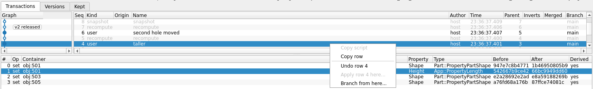

Right-click a row:

| Entry | What it does |
|---|---|
| **Copy script** | The text the row carries besides its operations, where it has any. |
| **Copy row** | The row as text. |
| **Undo row N** | Undoes this one step, though it is not the last: a new step that reverses it. Refused, with the reason in the report view, when something later changed what it touched. It is also the way to take back an `implicit` row by itself. |
| **Undo N rows** | The same with several rows selected: they are undone together, newest first, as one new step -- one Undo brings them all back. All of them or none: if one cannot be undone, nothing moves, and the report view says which and why. Rows that depend on each other go together where each alone would be refused -- the step that made an object and a later one that edited it. |
| **Apply row N here...** | For a row of *another* branch: what it set is written to this branch as a step of its own, after a preview like a merge's. Select several rows first to apply them together. Greyed for rows of this branch -- undo and redo are for those. |
| **Branch from here...** | A new branch whose history ends at this row, switched to. |
| **Roll back the merge of X...** | Appears when the last thing done was undoing a merge: takes the merge and its undo out of the log, so X counts as not merged. |

### Edit > Undo and the log

Edit > Undo and Redo work on the steps you named; the log records more.

- **A change made without a name goes with the step before it.** A
  recompute, or a property set from the Python console, is an `implicit`
  row. It is not in the undo list. One Undo takes the named step and the
  implicit rows after it; one Redo puts them back.
- **Several steps at once.** The arrow beside Undo lists the steps, newest
  first. Clicking one undoes every step from the newest down to it. The same
  for Redo. Steps in the middle cannot be picked there: for one of those,
  **Undo row N** in the row's menu, and for several, select them and
  **Undo N rows**.
- **A step that cannot be undone or redone** is said in a dialog, with the
  reason -- most often that something written since changed what the step
  set, and which row did. Nothing in the document moves. **Skip this step**
  leaves it where it is and takes the step after it; **Cancel** does nothing.
  The step stays in the list, and is asked about again the next time.
- A change made without a name does not empty the redo list, as a named step
  does. A redo is refused only if that change set the same property.

## 6. Seeing a change in the 3D view

The two lines at the bottom of the panel show, in the 3D view, how a
**shape** changed between two values the log holds.

### One operation

Select a row, then the operation that set an object's `Shape`:

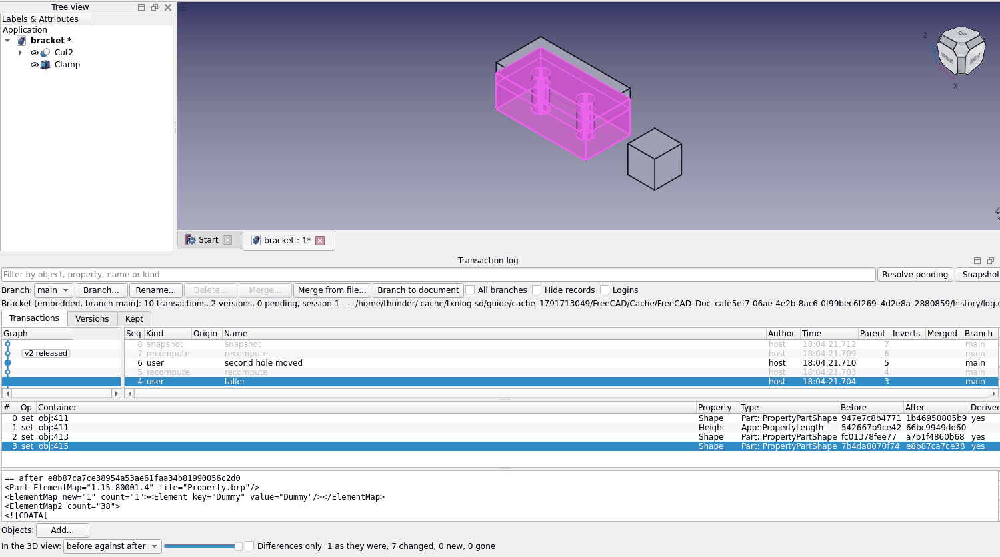

The two values are drawn over the object by their **material**:

- the solid that was **added** and the solid that was **removed**, each in
  a colour of its own (the colours of PartDesign's add and subtract
  previews);
- what **both** have, a faint grey.

Here the bracket was made taller: what was added is the slab on top, and
the status says how much.

The line "In the 3D view:" has:

| Control | What it does |
|---|---|
| The first list (`before against after`) | Which two values are compared; `nothing` turns the overlay off. |
| The second list (`Material` / `Faces`) | How a shape is shown: see below. |
| The slider | From the first of the two (left) to the second (right): which one is drawn solid and which as a ghost. |
| **Differences only** | Leaves out what did not change. |
| The text | What was found: `2.97 ml added, 0.00 ml removed, 7.43 ml in both`, in the units of your preferences. |

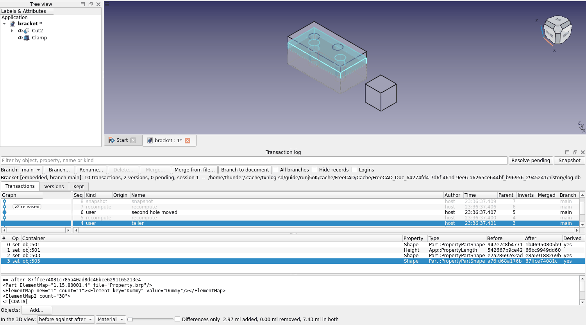

### Material or faces

**Material** answers *where* the object changed. The two solids are
taken apart into what only the first has, what only the second has, and
what they share, and the volumes are said. It needs two solids, and it
works them out by a boolean operation of the two.

On a heavy solid that takes time -- seconds at a thousand faces, the
better part of a minute at two thousand -- and you are not made to wait
for it: the faces are shown at once, the text says `working out the
material; the faces meanwhile: ...`, and the material takes their place
when it is there. Move on to another row and the work is dropped. Going
back to one of the last few pairs looked at costs nothing.

**Faces** answers *which faces* changed:

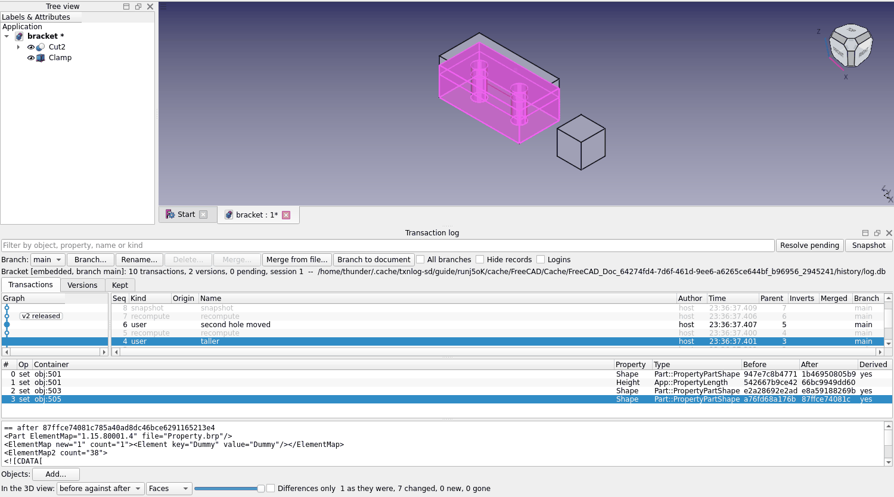

- faces that **changed** are tinted;
- faces that are **new** and faces that are **gone** have the colours of
  added and removed;
- faces that are **as they were** are a faint grey.

The text is then a count: `1 as they were, 7 changed, 0 new, 0 gone`. A
face counts as changed as a whole -- a box made taller has all four of its
sides changed -- which is why Material is what is shown first. Use Faces
when it is the faces you care about (what a reference to one of them will
find), and for anything that is not a solid.

Where one of the two values is no solid -- a shell, a sketch's face, or
an object that did not exist yet -- its faces are shown whichever is
asked for, and the text says so: `not two solids, by the faces: ...`.

### A whole row, a version or a merge: choose the objects

Select a row and no operation of it, and nothing is drawn: a file holds
objects that have nothing to do with each other, and all of them at once
says little. The bar tells you how many objects have changes:

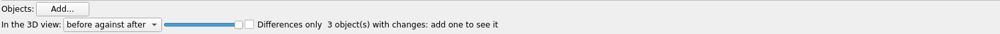

Choose the objects to look at on the line **"Objects:"**. It works like the
references of an attachment:

1. Select one or more objects, in the tree or the 3D view.
2. Click **Add...**. They are taken, each gets a button, and they are *no
   longer selected* -- so that the selection's highlight is not drawn over
   the overlay.

Or the other way round: click **Add...** with nothing selected (the status
says "Pick an object in the tree or the view"), then pick one.

- Click an **object's own button** to pick another in its place.
- Click the **x** beside it to let it go.

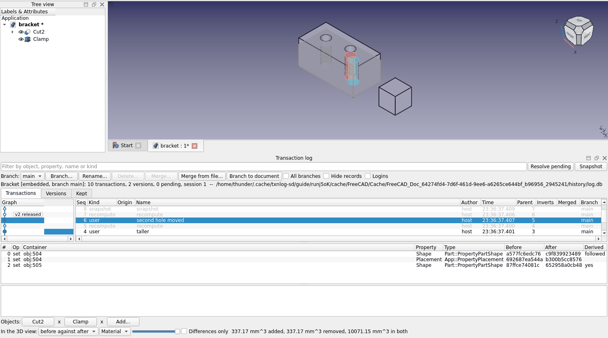

The objects **stay chosen** as you move from row to row, to the Versions tab
and back. Choose one object and step through the rows to follow it through
its history.

If the status says "No shape of what is chosen changed", the row changed
other objects than the ones you chose.

### The last change of one object, without the panel

Right-click an object in the 3D view and choose **Show last change**. The
entry is there when the log holds a change of the object's shape; an object
made and never changed since shows its making, all of it new.

The object goes into an edit, as it does for "Set colors...", and the task
panel says which step it was and has the same controls as the bar: by the
faces or by the material, the slider from **Before** to **After**,
**Differences only**, and what was found in words. **Close** ends it.

This one is not drawn in the document's own scene. In a document that is
shared, the people connected see it only if they are in the edit with you;
and someone looking at the document in a browser has the same entry in
their own right-click menu, with the panel and its slider on their page.
The panel there has the same **Close**:

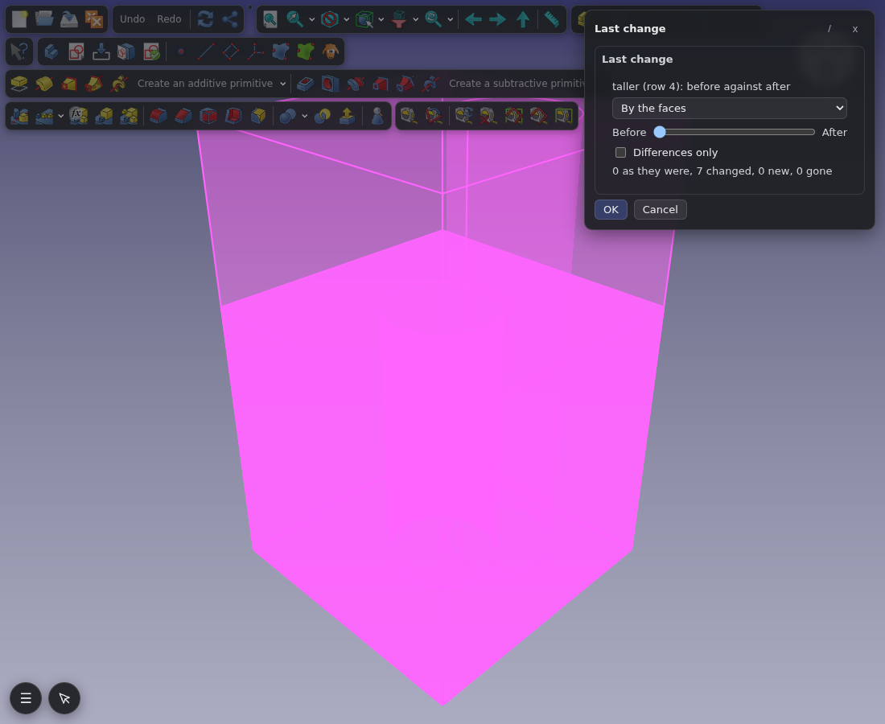

## 7. Versions: the document at a moment

A **version** is the whole document as it was at one row. Every save takes
one; **Snapshot** takes one without saving. A version is *unnamed* until you
name it, and unnamed ones may be dropped as the log is tidied; a **named**
version never is.

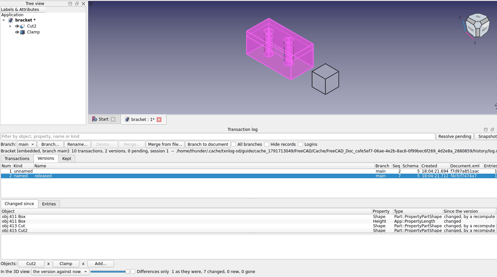

**Select a version** and the detail shows two tabs:

- **Changed since** -- everything that is not now as it was at that version,
  by object and property: `changed`, `new`, `gone`, an object `made` or
  `removed` since; "by a recompute" where it is a shape and not something
  you set. The 3D view shows the version against now, for the objects chosen
  in "Objects:" (section 6).
- **Entries** -- the files the version is made of. For looking under the
  hood.

**Select a line of "Changed since"** and that one value is shown: over its
object in the 3D view, and as text -- now, then at the version -- in the
value pane.

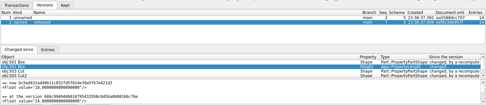

### The version's menu

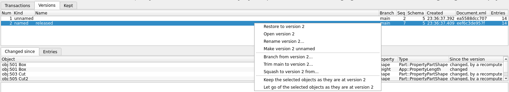

| Entry | What it does |
|---|---|
| **Restore to version N** | Makes the document what it was at that version, as one step you can undo. |
| **Open version N** | Opens the version as a document of its own, beside this one. It is read from the same file; its first change makes it a branch. |
| **Name version N... / Rename... / Make unnamed** | A named version is never dropped. |
| **Branch from version N...** | A new branch starting at the version, switched to. |
| **Trim BRANCH to version N...** | Removes the branch's history before the version. Asked first; it cannot be undone. What another branch holds, and named versions, stay. |
| **Squash to version N from...** | Folds the rows between an older version and this one into one row. Asked first; it cannot be undone. |
| **Keep the selected objects as they are at version N** / **Let go of...** | Section 8. |

## 8. Kept: shapes a save would leave out

A shape is something a recompute makes, and can be made again. So when a
document is saved, the shapes of old rows are mostly **left out of the file**
to keep it small (the values you set yourself are always there). A row whose
shape was left out still lists it, but there is nothing to show in the 3D
view.

To have a shape stay in the file, **keep** it. There are two ways:

**One value.** Right-click an operation that set a `Shape`:

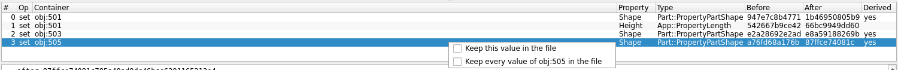

- **Keep this value in the file** -- this one shape, as this row left it.
- **Keep every value of obj:N in the file** -- every shape this object has
  had and will have. The file grows by each.

Or, for objects as they were at a version: select the objects, right-click
the version, **Keep the selected objects as they are at version N**.

An operation whose shape is kept reads `yes, kept` in the Derived column.

**The Kept tab** lists what is kept; its title carries the count.

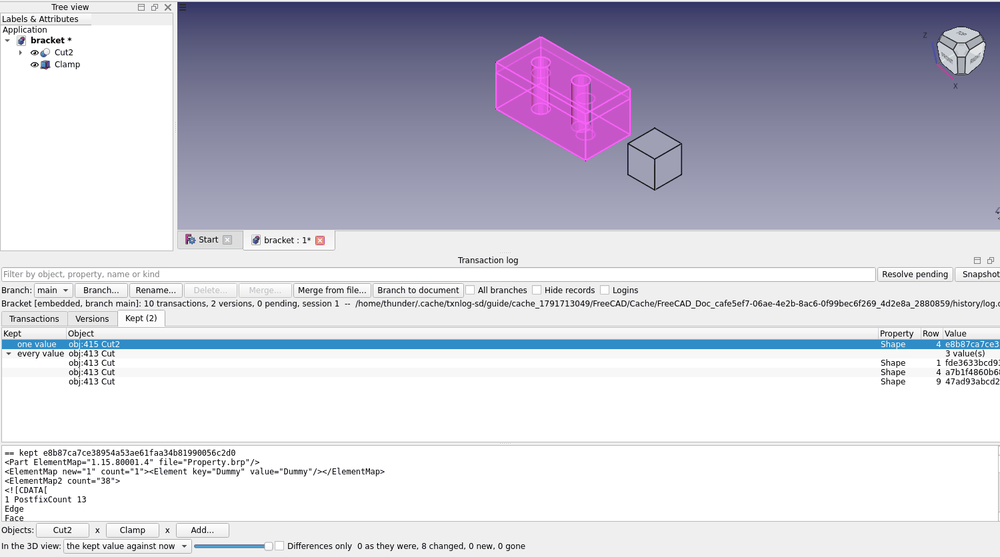

- `one value`: a shape kept by itself -- its object, its property, the row,
  the reference. If the row has since been trimmed away it reads
  "N, gone"; the shape is still there, and this list is where you find it.
- `every value`: an object kept, with each shape the log has of it listed
  under it.

Select a line to see that shape against the object as it is now. Right-click
for **Let go of this value**, **Stop keeping every value of...**, **Keep this
value by itself** (which holds it past a trim), and **Show row N**.

## 9. Branches

A branch is a second line of work on the same file. The document is always
on one branch; switching puts the document in the state of that branch's
last row.

| To... | Do this |
|---|---|
| start a branch here | **Branch...**, and give it a name |
| start one from an earlier point | right-click a row, **Branch from here...**; or a version, **Branch from version N...** |
| switch | choose it in the **Branch:** list |
| see every branch's rows | tick **All branches** |
| work on two at once | **Branch to document**: the new branch opens as a second document of the same file |
| rename, delete | **Rename...**, **Delete...** |

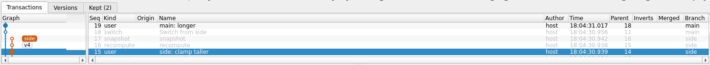

With **All branches** ticked, the graph draws each branch as a line of its
own colour, with its name at its head.

A row of another branch can be applied here without merging the branch:

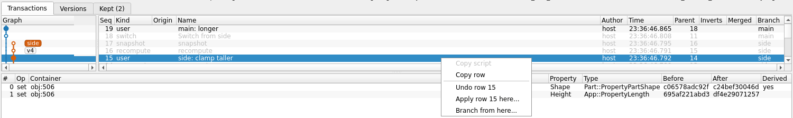

## 10. Merging

**Merge...** (or right-click a request, section 11) brings what another
branch changed into the branch you are on. Before anything is done you get
a **preview**:

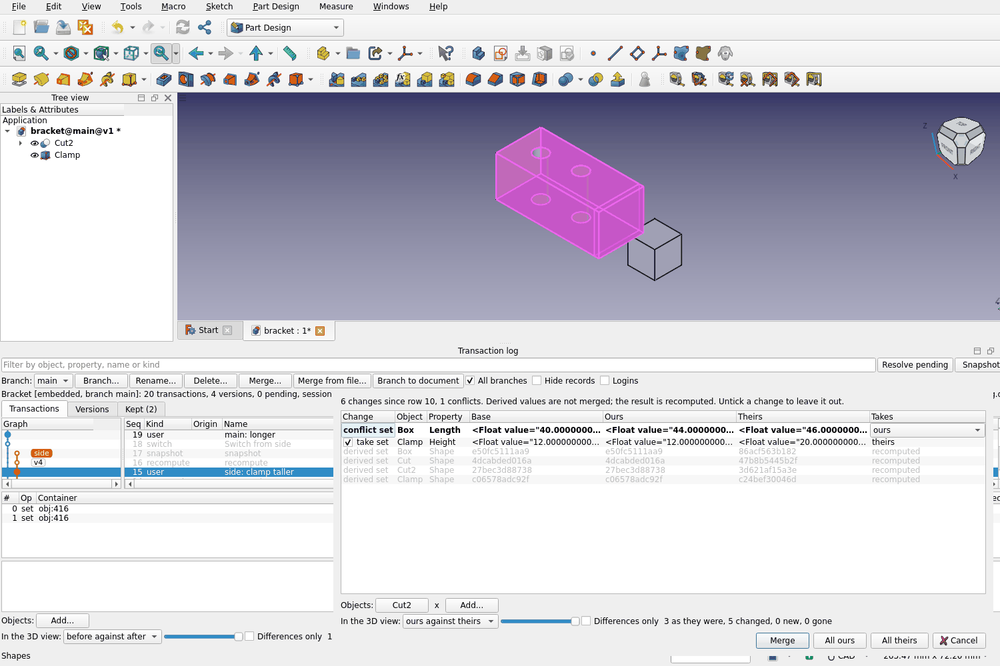

The first line says how many changes there are and how many are conflicts.
The list has one line per change the other branch made:

| Change | Meaning | What you do |
|---|---|---|
| **conflict** (bold, first) | Both branches changed it, differently. | Pick a side in the **Takes** column: `ours` or `theirs`. It starts on `ours`. The setting `MergeConflictSide` (Preferences/Document) changes that: 1 starts it on `theirs`, 2 starts it with no side, and **Merge** then waits until you have picked one for each. |
| **take** | Only the other branch changed it; it goes in. | Untick it to leave it out. |
| **merge** | Both changed it, and it holds many things (a sketch's constraints, a sheet's cells); the two are combined. | Untick to leave theirs out. |
| **derived** (grey) | A shape their recompute made. Not merged: the result is recomputed. | Nothing. |
| same, unit, named (grey) | Nothing to decide. | Nothing. |

**Base**, **Ours** and **Theirs** show the value where the two branches
parted, the one here, and the one there.

**All ours** / **All theirs** set every conflict at once. **Merge** does it,
as one step that can be undone. **Cancel** does nothing.

### Looking at it in the 3D view

The preview has the same two lines as the panel. Choose objects in
"Objects:" and the view shows `ours against theirs` for them; the list
offers `base against ours` and `base against theirs` too. Select a line of
the list to see that one change over its object:

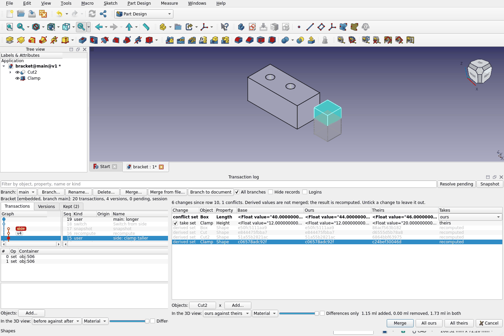

### What the merge would make

`ours against theirs` shows the other branch, which is not what you get: a
merge keeps what you changed and adds what they changed. The last entry of
the list, **ours against the result**, shows that. Here this branch made
the box taller and the other made it longer and added a ball. Against
theirs, the height you added shows as removed:

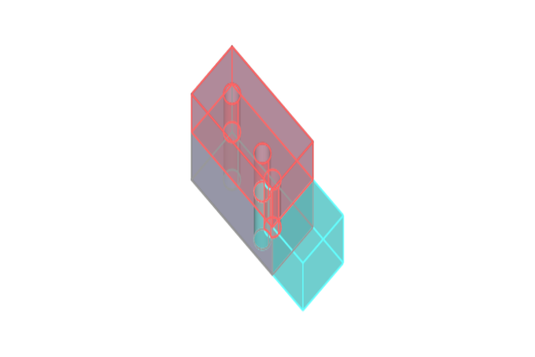

Against the result it is kept, the extra length is added, and the ball is
there as new:

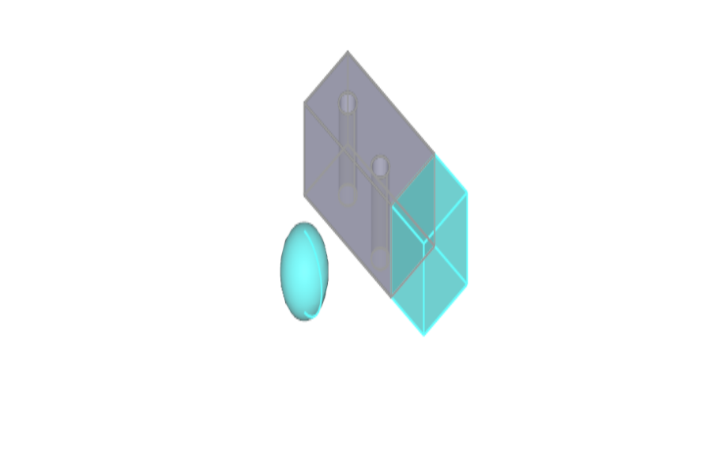

The result is worked out when you choose that entry, with the sides picked
as they are at that moment, and again when you pick another side or untick
a change. It is made in a hidden copy of the document, so nothing here
changes: no undo step, and a step you had undone can still be redone. On a
large document expect to wait about as long as opening it takes.

The status line also says what the picture cannot: how many objects the
merge makes or removes, and **which objects fail to compute in the result**.
Two changes that each work alone can break a feature together; this tells
you before you merge.

When the other branch is simply ahead of this one (a fast-forward), the
result is that branch, and the line says so.

The preview **does not block the rest of the application**: turn the view,
pick objects, hide things, while it is open.

### If the document changes while the preview is open

You can even edit the document. If the edit changes what the merge would do
-- you changed something the other branch changed too -- the preview says so
and **Merge** is disabled:

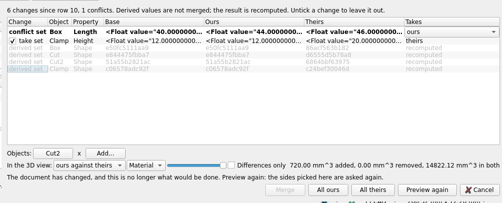

Click **Preview again** to have it made anew; the sides you had picked are
asked again. An edit the merge does not care about leaves the preview as it
is.

Only one preview is open at a time. Closing the document, or making another
document the active one, closes it.

### After a merge

- **Undo** takes the merge back, like any step.
- With the merge undone, right-click a row, **Roll back the merge of X...**
  to take it out of the log altogether; merging X again then asks
  everything again.

### Merging from another copy of the file

**Merge from file...** takes another copy of this file -- one a colleague
edited, say. What was done to it since the two copies parted comes in as a
branch named after it, each row under its author, and is then previewed and
merged like any branch. A file with several branches asks which one.

## 11. Requests: changes someone sends you

When someone working on a copy sends their changes -- from a shared session,
or as a file brought in and not yet merged -- a list of **requests** appears
above the tabs. It is hidden while there are none.

- **Double-click** a request to bring it in and open the merge's preview.
- **Right-click a file that was sent** for: *Bring in and merge...*, *Bring
  in only* (it becomes a branch and waits), *Save a copy as...*, *Delete,
  unread*.
- **Right-click a branch that was brought in** for: *Merge...*, *Open in a
  document of its own*, *Delete*.
- **Right-click a merge that was asked for** (*merge A into B*, from
  someone connected to the shared document, section 12) for: *Merge...*,
  when the document is on the branch it goes into, and *Reject*.

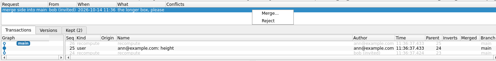

The Conflicts column says how many conflicts a merge would have, before you
open it. It is empty for a merge that was asked for: its preview says.

## 12. The history in a browser

Someone connected to a shared document in a browser has a panel of their
own for its history: **History** in the page's menu (the three lines at the
bottom left). It is offered to people who may edit; someone who may only
look does not have it, and cannot read the history any other way.

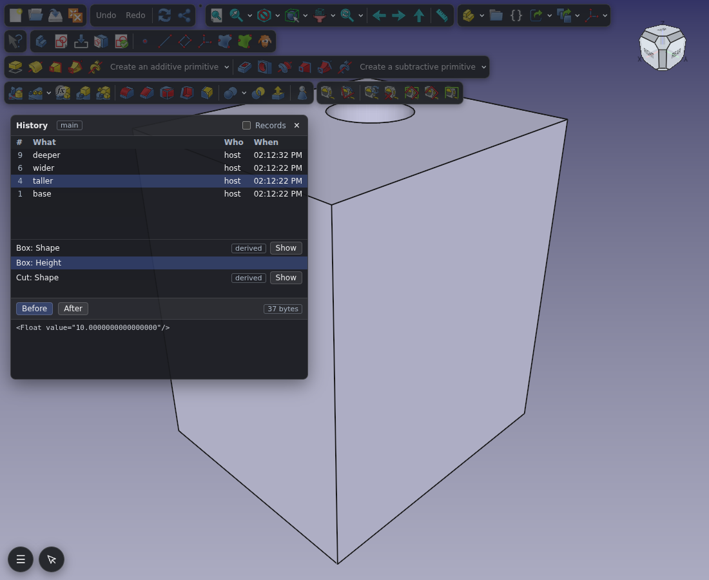

It reads from top to bottom:

- **The steps**, newest first: number, name, who made it, when. Steps
  that changed nothing -- a recompute's record, someone connecting -- are
  left out until **Records** is ticked. A step of another branch is in
  italics, with the branch's name. **Load older** fetches the next hundred.
  The list keeps itself up to date while the document is worked on.
- **The operations** of the step you click: which object, which property.
  An object that has since been removed is in italics.
- **The value** of the operation you click, **After** or **Before**. A long
  value, such as a shape, shows its start and says how long it is.

An operation that changed a shape has a **Show** button. It does what
"Show last change" does (section 6), for that step instead of the last one:
the object goes into an edit, the panel with the slider comes up, and
**Close** ends it.

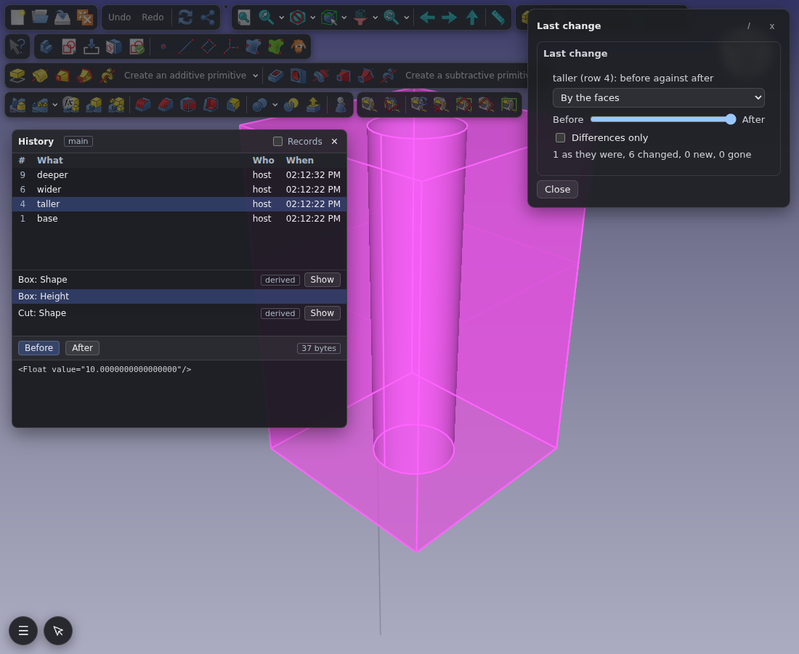

What the panel lets you do depends on what the sharer lets you do with
each branch: **read** it, or **write** it. Whatever you ask is done by the
computer that shares the document, and the panel says in one line what it
did, or in red why it did not. A button that is greyed says in its tip
whose it is to press. A branch you may not read is not in any list.

**In a document shared as it is**, everybody is in the same document, and
where it is in its history is for the person sharing it to decide: you
read its branch. You can:

- **Undo a step of your own that is not the last.** Click the step, then
  **Undo row**. To undo several as one, hold Ctrl (or the command key)
  while clicking, or Shift for all between two; on a phone tick **Several**
  first. A step is refused when something later changed what it touched,
  and the panel says what and by which step (section 5). Somebody else's
  step is theirs to undo, or the sharer's.
- **Take a version**: **Snapshot...**, with a name to keep it.

Switching branch, making, renaming or deleting one, restoring a version
and renaming one are the sharer's there.

**In a branch served to you** you have a document of your own: the sharer
made a branch where their document was and opened it for you, and theirs
does not move with what you do. From that point on you write it:

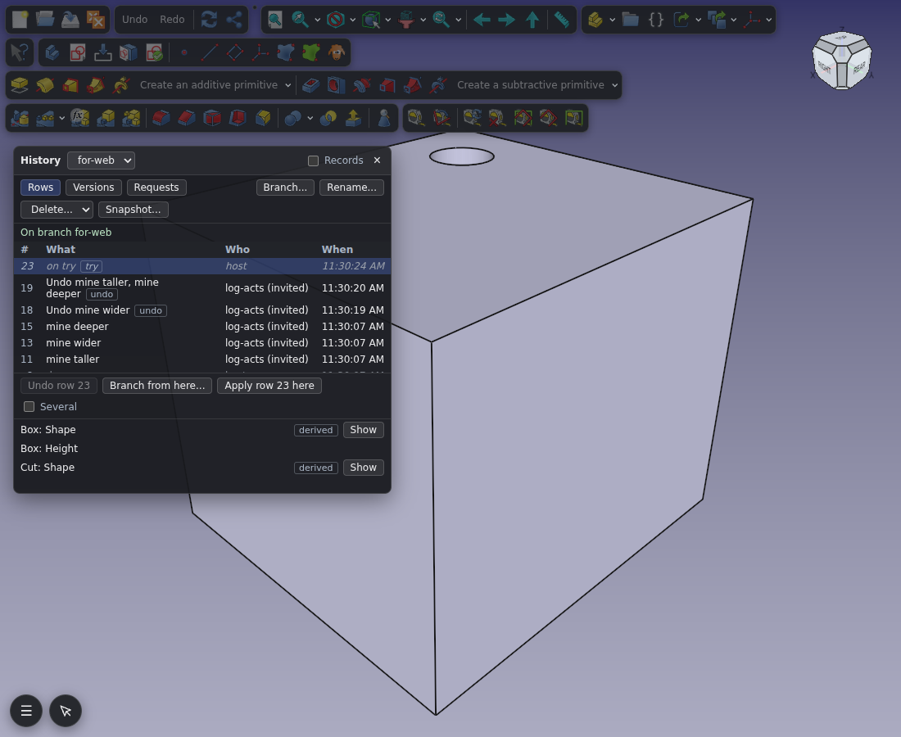

- **Branches.** The list beside the title is the branch the document is on;
  choosing another switches to it. **Branch...** makes one from where the
  document is, **Branch from here...** from the step or the version you
  clicked, **Rename...** renames the one you are on, and **Delete...**
  removes one you made -- for good. Switching waits until nobody has an
  edit open.
- **Versions**, the second list. Click a version to **Restore** the
  document to it -- one step, which undo takes back -- or to name, rename
  or unname it.
- Undoing a step of your own and taking a version, as above.

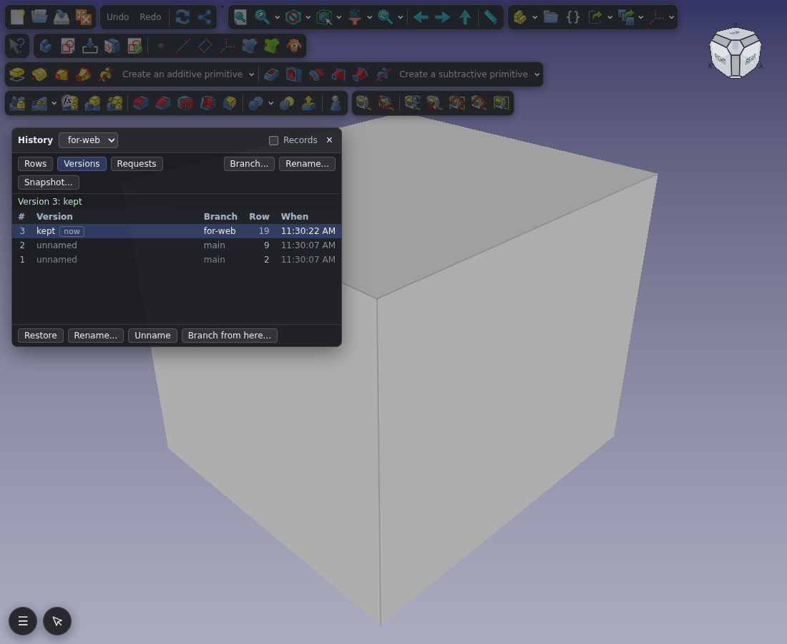

What was there before the branch was served to you is listed in grey: you
can read it, undo a step of your own in it, and go back to the point you
were served from, but no further. The branch you were given is not yours
to delete. The sharer's branch, the one yours was made from, is in the
list too: you read it.

**A branch you read and are not on.** Its steps are in the list in
italics, with its name. Two things can be done with it:


- **Take a step of it.** Click the step, then **Apply row N here**: what
  that step set is written to the branch you are on, as one step of your
  own, which undo takes back. Several at once as for undo. Where a step
  sets something that was also set here since the two branches parted,
  the panel asks one question for all of them: **Take theirs**, **Keep
  ours**, or **Pick each...**, which lists what it would do with a side
  to pick for each conflict (below).
- **Ask for a merge.** The third list, **Requests**, has a line at its
  top: *Merge* a branch *into* another, a note if you like, **Ask**. Both
  must be branches you read. This is how the work you did in a branch
  served to you goes back: ask for your branch to be merged into the
  sharer's.

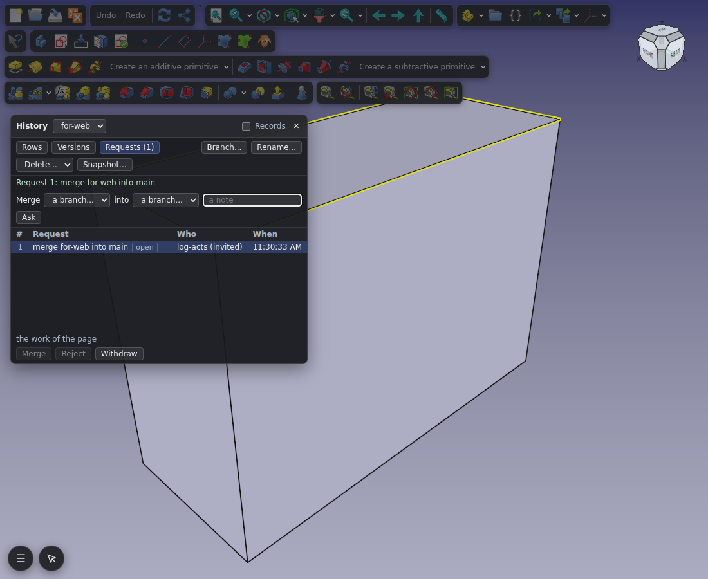

A request stays in the list, open ones first, with who asked and when,
and the number of open ones is in the list's name. Click one to act on
it: **Withdraw** takes back one of your own; **Merge** and **Reject** are
for whoever writes the branch it is to go into -- and a merge is done in a
document that is on that branch, so the button says so when yours is not.
A merge that meets conflicts asks the same one question. **Look first...**
opens the list before anything is merged.

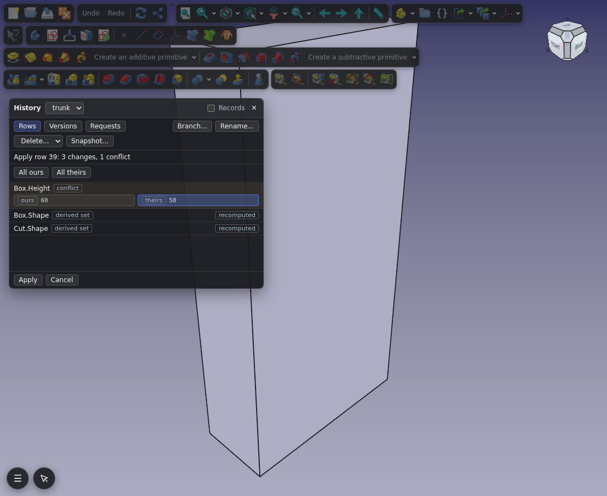

**The list of what it would do** takes the place of the panel's lists
while it is open. The conflicts come first: each shows its value here
(**ours**) and its value on the other branch (**theirs**) -- click the
one that is to stay; the tip says what it was where the two branches
parted. **All ours** and **All theirs** pick every one. The rest says
what goes in of it, with a tick: untick one to leave it out, and what is
here stays. **Apply** or **Merge** waits until every conflict has a side;
**Cancel** leaves everything as it was.

**A merge that was undone** can be taken out of the history altogether,
as on the desktop (section 10): click the merge, or the undo of it, and
**Roll back merge...**. Its steps leave the history, and a merge of that
branch later asks everything again; the document does not change. It is
the sharer's, or yours for a merge you made yourself on a branch you
write.

**Shapes kept in the file** (section 8). Click an operation that set a
shape: **Keep** beside its value keeps that shape in the file, **Keep
all of it** every shape that object has had and will have, and the
operation then says *kept*. A version has **Keep selected here**: the
objects you selected, as they were at that version. The fourth list,
**Kept**, shows what is kept -- its name carries how many -- and a line of
it shows its value, **Show** draws it over its object against what the
object is now (as **Show** on an operation does), **Show row N** goes to
its step, and **Let go** lets
it go: the next save leaves it out of the file, for good. So keeping is
anybody's, but letting go is the sharer's, or yours for a value kept at a
step of a branch you write; stopping every shape of an object being kept
is the sharer's.

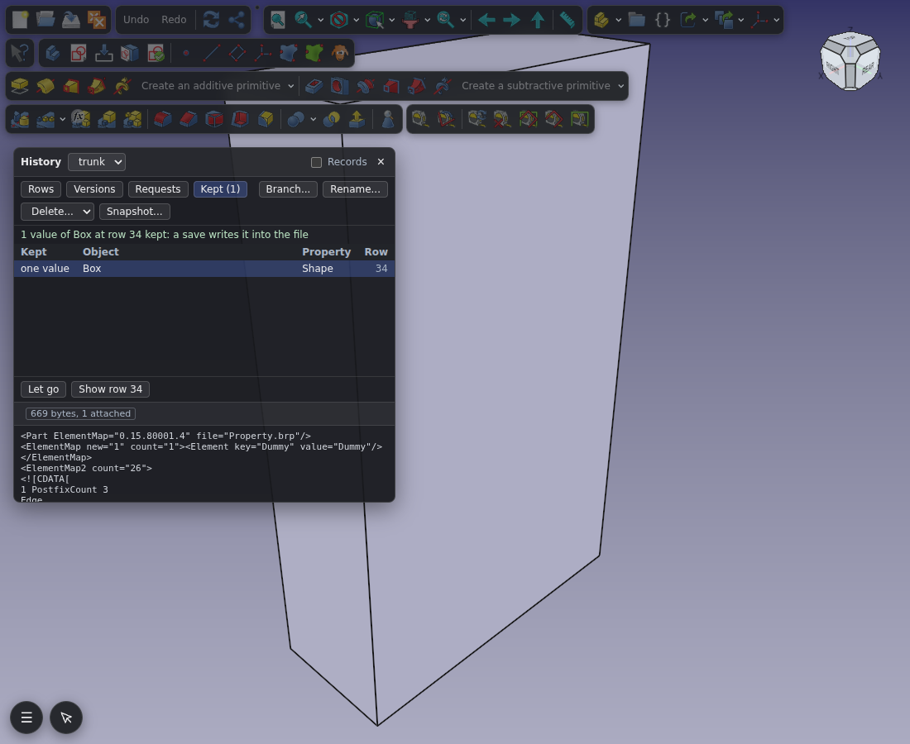

**For the sharer**, in the Transaction Log panel on the desktop:

- **Serve branch...** makes a branch where the document is and serves it
  in a document of its own, with no window. It asks for the branch's name
  and the status line then says the document's name, which is what someone
  joins it by. The button is there for a document that is shared.
  (`Gui.serveBranch(App.ActiveDocument, "name")` does the same from the
  Python console.)
- **Access...** says who may what, and lists what has been said: pick a
  user -- anyone who has connected to the document -- **reads** or
  **writes**, the branch, and for a write the version it starts from, or
  where the branch forks. **Set** says it, **Remove** takes the chosen
  line away. With nothing said for someone, they read the branch of the
  document they joined and write a branch that was served to them, as
  described above; a line here is in place of that, so a served branch can
  be made read only for one person.

  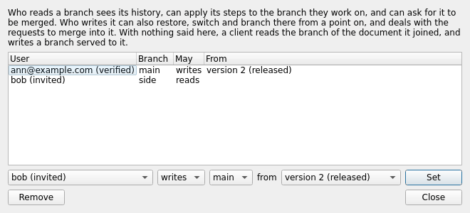
- **The merges asked for** are in the panel's request list (section 11),
  beside the files that were sent: *merge A into B*, who asked, the note.
  Double-click one, or **Merge...** in its menu, to open the merge's
  preview -- where each conflict is given its own side -- when the document
  is on the branch it goes into; **Reject** ends it. However the merge is
  done, the request is answered by it.

Trimming and squashing are done in the desktop's panel.

## 13. I want to...

| I want to... | Where |
|---|---|
| see what a step changed | Transactions: select the row, read its operations |
| see the old and new value of a property | select the operation; the value pane |
| see how an object's shape changed in a step | select the row, then its `Shape` operation |
| see the last thing that changed an object, quickly | right-click the object in the 3D view, **Show last change** |
| see how much material a step added or removed | the same, with **Material** in the bar's second list; the status says the volumes |
| see which faces a step changed | the same, with **Faces** |
| follow one object through the history | add it to "Objects:", then step through the rows |
| compare the document now with an earlier state | Versions: select the version; "Changed since" |
| undo one step that is not the last | right-click the row, **Undo row N** |
| undo several steps that are not the last, together | select the rows, right-click, **Undo N rows** |
| go back to an earlier state | Versions: right-click, **Restore to version N** |
| look at an earlier state without changing anything | Versions: right-click, **Open version N** |
| mark a state so it is never dropped | Versions: right-click, **Name version N...** |
| try something without disturbing the main line | **Branch...** |
| bring a branch's work back | **Merge...** |
| take one step of another branch, not the whole | tick **All branches**, right-click the row, **Apply row N here...** |
| merge a colleague's copy of the file | **Merge from file...** |
| keep an old shape in the file | right-click its operation, **Keep this value in the file** |
| see what is kept, and let it go | the **Kept** tab |
| make the file's history shorter | Versions: **Trim...** or **Squash...** |
| read the history from a browser | the page's menu, **History** (section 12) |
| undo a step of your own, or take a version, from a browser | **History**: click the step, then **Undo row**; **Snapshot...** (section 12) |
| give someone a branch of their own to work in from a browser | `Gui.serveBranch(doc, "name")`; they switch, branch and restore there (section 12) |
| see what one step did to a shape, from a browser | **History**: click the step, then **Show** on its shape |

## 14. The same from Python

Everything the panel does is a method of the document.

| Panel | Python |
|---|---|
| the rows, a row's operations | `doc.getTransactionLog()`, `doc.getTransactionOps(seq)` |
| a value | `doc.getTransactionValue(ref)` |
| a shape the log holds | `Part.getTransactionShape(doc, ref, obj.ID)` |
| what became of each face | `before.diff(after)` |
| the material added and removed | `before.diffMaterial(after)` |
| the overlay in the 3D view | `obj.ViewObject.showValueDiff("Shape", refBefore, refAfter, mode="material")`, `getValueDiff()`, `hideValueDiff()` |
| Snapshot, name a version | `doc.snapshotTransactionLog()`, `doc.nameTransactionVersion(num, name)` |
| the versions | `doc.getTransactionVersions()` |
| Changed since | `doc.compareTransactionStates(seq, 0)` |
| Restore, Open version | `doc.restoreTransactionVersion(num)`, `doc.openTransactionVersion(num)` |
| Undo row, Undo N rows | `doc.undoTransactionFromLog(seq)`, `doc.undoTransactionFromLog([seq, ...])` |
| Branch, switch, rename, delete | `doc.createTransactionBranch(name)`, `doc.switchTransactionBranch(name)`, `doc.renameTransactionBranch(...)`, `doc.deleteTransactionBranch(name)` |
| the merge's preview, the merge | `doc.previewTransactionMerge(name)`, `doc.mergeTransactionBranch(name, picks)` |
| Apply rows | `doc.previewTransactionPick(rows)`, `doc.pickTransactions(rows, picks)` |
| Merge from file | `doc.importTransactionFork(path)` |
| Keep, let go, list | `doc.keepTransactionValue(obj, prop, seq)`, `doc.keepTransactionValuesOf(obj)`, `doc.releaseTransactionValue(ref)`, `doc.getKeptTransactionValues()`, `doc.getKeptTransactionObjects()` |
| Trim, Squash | `doc.trimTransactionBranch(name)`, `doc.squashTransactionVersions(first, last)` |

Each has its arguments and what it returns in its docstring:
`help(doc.previewTransactionMerge)`.

## 15. Taking the pictures again

The pictures are taken by a script that builds a small document, edits,
branches and merges it, and drives the panel through this guide. Run it
after the panel changes, under a display (the offscreen platform draws
nothing):

```
cd build/conda-relwithdebinfo-801
d=$(mktemp -d)
GUIDE_OUT=$PWD/../../docs/images/transaction-log \
  FREECAD_USER_HOME=$d/home XDG_CACHE_HOME=$d/cache \
  xvfb-run -a -s "-screen 0 1500x1000x24" \
  ~/works/sw/fcad/.conda/run.sh ./bin/FreeCAD ../../scripts/transaction-log-guide-shots.py
```

A fresh home and cache each time: the run ends abruptly, and the next one in
the same cache would be offered the document to recover, over the pictures.
`shots.txt` beside the pictures lists what was taken, and any error.

The pictures of section 12 are a browser's, and that script does not take
them. They are written by the two browser tests into their output directory
-- `log.png` and `shown.png` by `tests/gui/serve-log-browser.py`, `acts.png`
and `versions.png` by `tests/gui/serve-log-acts-browser.py` -- and copied
from there as `14-log-browser*.png` and `15-log-browser-*.png`. Both tests
say in their first lines how they are run.
